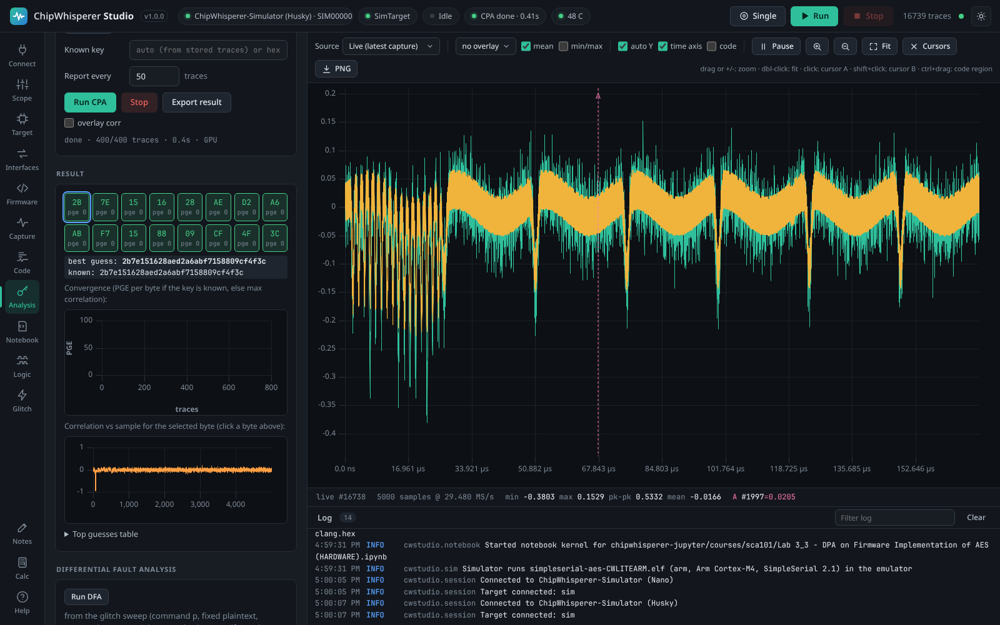
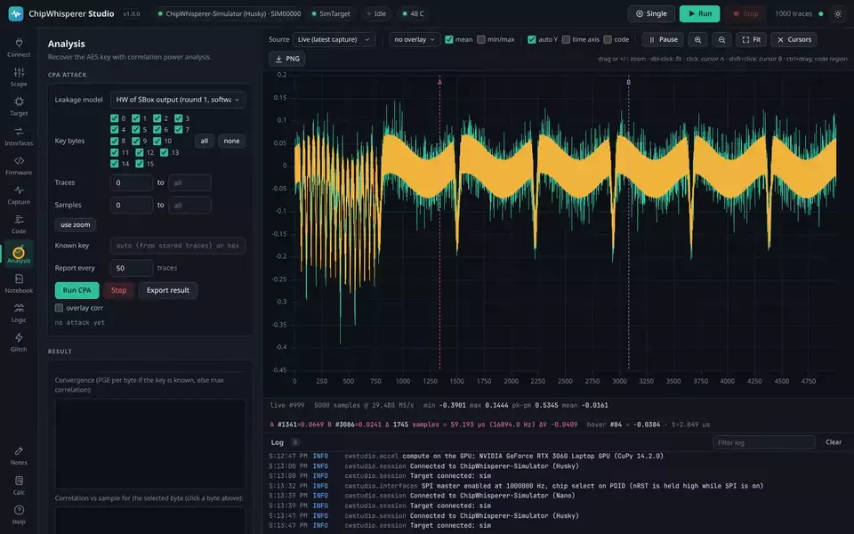

# CPA and leakage analysis

The **Analysis** tab recovers keys and measures leakage from the traces in memory. It runs a correlation power analysis (CPA) attack, assesses leakage with TVLA and SNR, conditions traces (alignment and filtering), and recovers a key from faults with differential fault analysis.

<picture><source media="(prefers-color-scheme: light)" srcset="images/analysis-light.png"></picture>

## Correlation power analysis

CPA guesses each key byte on its own: for every candidate it predicts a leakage value from a model, correlates the prediction with the measured power at each sample across all traces, and keeps the candidate whose correlation peaks highest. With enough traces the right byte stands out.

Press **Run CPA**. The attack is **progressive**: it folds in traces in batches and updates after each, so the key bytes and the partial guessing entropy (PGE) converge as it runs. Pick which key bytes to attack, the trace and sample ranges (use the waveform zoom to set the sample window), and how often it reports.

### Leakage models

| Model | Predicts |
|-------|----------|
| S-box output HW | Hamming weight of the first-round S-box output (the classic AES model). |
| plaintext XOR key HW | Hamming weight of the AddRoundKey output. |
| inverse S-box HW | Hamming weight of the inverse S-box, for decryption. |
| last round HD | Hamming distance across the last round, recovered from the ciphertext. |
| last round HW | Hamming weight of the last-round state. |
| S-box LSB, S-box MSB | A single bit of the S-box output (a DPA-style bit model). |
| AES-256 round 2 HW | The second-round key for AES-256. |
| custom | A NumPy expression you write over the plaintexts, ciphertexts and guesses. |

With a known key (entered, or read from the stored traces) the recovered bytes are marked right or wrong and the PGE is shown. **Export** writes the result (per-guess maxima, best correlation traces, the history and a summary) to disk.

## On the GPU

When a CUDA GPU with CuPy is present, Studio runs the CPA on it automatically for large attacks, with a CPU fallback. A 5000-trace attack over 24400 samples drops from about 18 s on the CPU to 1.3 s on an RTX 3060. The compute backend is shown in the **Connect** card ("Compute") and tagged in the Analysis status while it runs. Turn it off with `CWSTUDIO_GPU=0`, or install the extra with `pip install chipwhisperer-studio[gpu]`. See [Performance](Performance).

## Leakage assessment

The **Leakage assessment** card measures whether and where an implementation leaks, without attacking it:

- **TVLA t-test.** Welch's t-test per sample between the traces captured with a fixed plaintext and those with random plaintexts. Capture with the plaintext mode set to **tvla** so the two groups interleave. A `|t|` above 4.5 at any sample means the implementation leaks there.
- **SNR.** The signal-to-noise ratio per sample for one key byte, classing traces by the S-box output Hamming weight under the known key, or by the plaintext byte value.
- **Spectrum.** The frequency content of the mean trace, to spot a clock or switching frequency.

## Trace conditioning

The **Trace conditioning** card cleans traces before an attack. Both operations change the stored traces in place, so export first if you want the originals.

- **Align.** Shift each trace so a chosen window matches a reference by cross-correlation, for captures with a jittered trigger.
- **Filter.** A windowed-sinc FIR low-pass, high-pass or band-pass with cutoffs as a fraction of the sample rate.

## Differential fault analysis

The **Differential fault analysis** card recovers an AES-128 key from ciphertexts a glitch faulted. See [Glitching and fault analysis](Glitching#differential-fault-analysis-aes) for the campaign that produces the faults; the card runs from the last glitch sweep or from ciphertexts you paste (the correct one first).

## From the API and MCP

- `POST /api/analysis/cpa/start`, `GET /api/analysis/cpa`, `POST /api/analysis/cpa/export`.
- `POST /api/analysis/ttest`, `/api/analysis/snr`, `/api/analysis/spectrum`, `/api/analysis/align`, `/api/analysis/filter`, `/api/analysis/dfa`.
- MCP: `cpa_start`, `cpa_result`, `cpa_export`, `leakage_ttest`, `leakage_snr`, `dfa_aes`.

A header indicator shows which of these is running and what finished last. See also [Capturing Traces](Capturing-Traces) and [Quick Start](Quick-Start).
