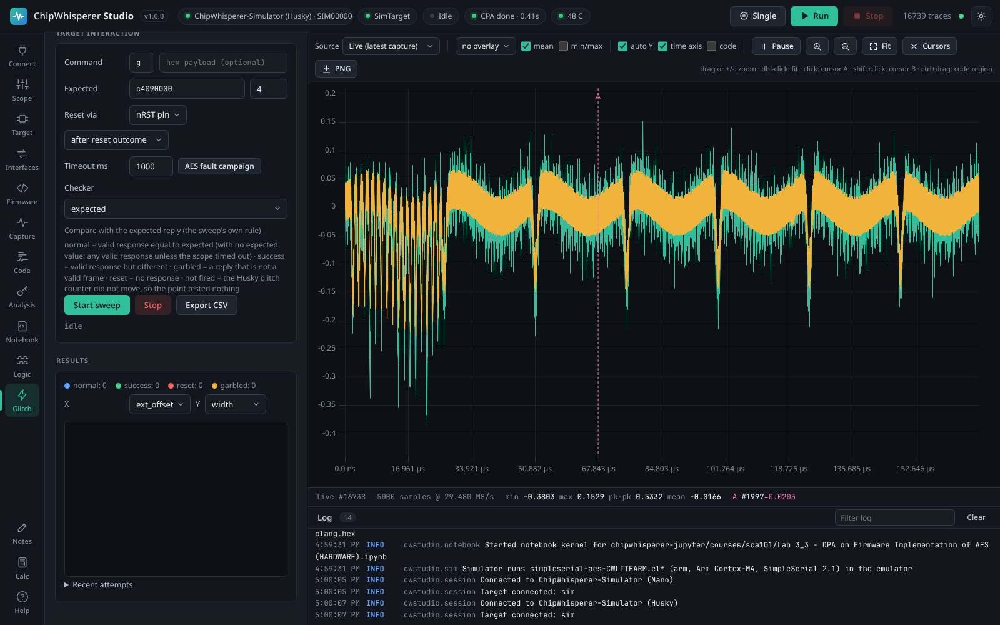
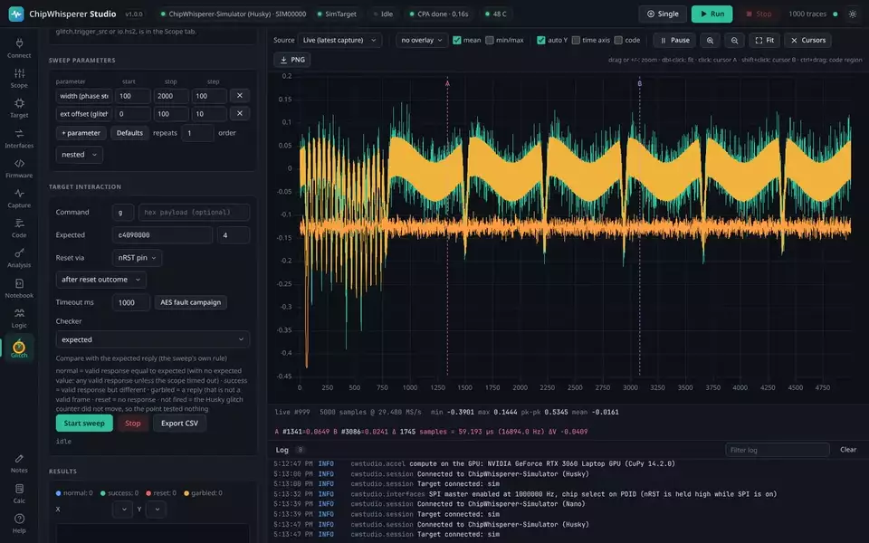

# Glitching and fault analysis

The **Glitch** tab runs fault-injection campaigns: it drives the connected scope's glitch engine, sweeps its parameters, classifies what the target does at each point, and (for AES) recovers the key from the faults with differential fault analysis.

<picture><source media="(prefers-color-scheme: light)" srcset="images/glitch-light.png"></picture>

## The engine for your model

Each ChipWhisperer model glitches differently, so the top card shows the engine of the connected scope and offers its presets:

| Model | Engine | Parameters | Presets |
|-------|--------|------------|---------|
| Nano | Firmware crowbar: one MOSFET fired a set number of CPU cycles after the trigger | `glitch.ext_offset` and `glitch.repeat` in 8.3 ns cycles | Enable crowbar, Disable |
| Lite, Pro | Two phase-shifted DCM clocks | `glitch.width` and `glitch.offset` in percent of a clock period (plus fine steps) | Clock, Voltage LP/HP/Both, Disable |
| Husky, Husky Plus | MMCM phase shifter, up to 32 glitches per trigger with a fired counter | `glitch.width` and `glitch.offset` in phase steps | Clock, Voltage LP/HP/Both, Disable |

A line under the engine converts the current settings to nanoseconds using the target clock, so you can see how long a glitch is regardless of the units. The presets call the library's own setup functions (`cglitch_setup`, `vglitch_setup`) and leave your capture settings alone; anything finer, such as `glitch.trigger_src` or `io.hs2`, is in the **Scope** tab.

## Sweeping

Add one or more parameter rows (any `glitch.*` path the model has), each with a start, stop and step, or an explicit list of values. Studio tries every combination, in nested or random order, `repeats` times each. The **Defaults** button fills the usual starting sweep for the engine.

For each point Studio optionally resets the target, arms the scope, sends a SimpleSerial command with your data, and reads the reply. The result is classified and plotted live:

| Outcome | Meaning |
|---------|---------|
| normal | A valid reply equal to what was expected (or, with no expected value, any valid reply unless the scope timed out). |
| success | A valid reply that differs from the expected one: the glitch changed the computation. |
| reset | No reply: the target crashed or restarted. |
| garbled | A reply that is not a valid frame. |
| not fired | Only on a Husky: the glitch counter did not move, so the point tested nothing. Check `glitch.trigger_src` and the arm timing. |

The scatter plots any two swept parameters against each other; pick the axes under the plot. Export every attempt to CSV with **Export CSV**.

## Result checkers

The default classification looks only at whether the reply is valid and matches the expected value. A **checker** refines it from what the reply *means*:

| Checker | What counts as success |
|---------|------------------------|
| expected reply | The built-in rule above. |
| loop counter | The little-endian counter in the reply came out lower than expected (the `simpleserial-glitch` loop skipped iterations). |
| AES fault | The ciphertext differs from the correct one in exactly one MixColumns column, a usable fault for the DFA below; any other difference is garbled. |
| flag | Any non-zero byte in the reply, for a bypassed password or signature check that answers 1. |
| expression | A one-line Python expression over the reply context (`value`, `expected_value`, `resp`, `fired`, `outcome`, ...). |
| your own file | A `.py` with a `check(ctx)` function in the data folder's `checkers` directory. |

A checker that raises marks that one attempt garbled with the error, so a bad expression never stops a long sweep. Each attempt's checker verdict is shown in the results table and the CSV.

## Differential fault analysis (AES)

A glitch that corrupts one byte of the AES state as it enters the ninth round spreads to exactly four ciphertext bytes, one MixColumns column. About two such faults per column, roughly eight in all, pin the tenth round key; running the key schedule backwards gives the master key (Piret and Quisquater, CHES 2003).

The **AES fault campaign** button in the Glitch tab sets this up: command `p`, a fixed random plaintext, the target's correct ciphertext as the expected reply, 16-byte output and the AES-fault checker. Sweep `glitch.ext_offset` across the last rounds, then open the **Analysis** tab's **Differential fault analysis** card and press **Run DFA**. It reports the tenth round key and master key once every column is unique, or how many candidates each column still has, and which ciphertexts were unusable and why. You can also paste a correct ciphertext and faulty ones directly.

## On real hardware

Whether a target glitches at all depends on the target, not on Studio. A device with an internal PLL or clock filter ignores a clock glitch, so reach for the crowbar (voltage) instead; a resistant target may need a narrow, well-placed pulse found by sweeping `glitch.ext_offset` finely and repeating each point, because the trigger has jitter. The **Health** card (see the header chip) shows when the Husky's XADC alarm has powered the glitch down after a long crowbar sweep, with a Clear action.

## From the API and MCP

- `POST /api/glitch/start` with the sweep parameters, `checker` and `checker_expr`; `GET /api/glitch/results`; `GET /api/glitch/checkers`; `POST /api/glitch/export`.
- `POST /api/analysis/dfa` from the last sweep or from pasted ciphertexts.
- MCP: `glitch_start`, `glitch_results`, `glitch_checkers`, `glitch_export`, `dfa_aes`, and `scope_action` for the presets.

See also [Capturing Traces](Capturing-Traces), [Scope Settings](Scope-Settings) and [Code on the Waveform](Code-on-the-Waveform).
